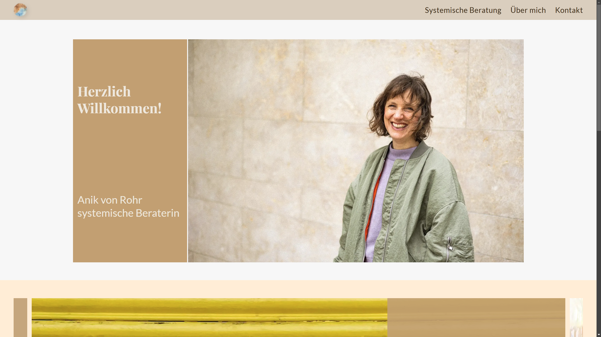

# Anik von Rohr | Systemische Beratung - Website



Diese [Website](https://www.anikvonrohr.de) wurde entwickelt, um Anik von Rohr, eine systemische Beraterin, online zu präsentieren. Das Ziel der Webseite ist es, die Reichweite zu fördern und mehr Kunden anzusprechen. Sie stellt wichtige Informationen bereit, um Interessenten zur Kontaktaufnahme zu bewegen.

## 🚀 Technologien

- **[Astro 7](https://astro.build/)** – statische Seiten, optimierte Bilder (`astro:assets`), Sitemap & robots.txt
- **[Tailwind CSS 4](https://tailwindcss.com/)** – Design-Tokens in `src/styles/global.css` (`@theme`, `@utility`)
- **Selbst gehostete Schriften** via Fontsource (Playfair Display, Lato) – keine Verbindung zu Google Fonts
- **Native Web-Plattform statt Frameworks**: Popover-API für das mobile Menü, CSS View Transitions für Seitenwechsel
- **Matomo** (selbst gehostet, ohne Cookies) für die Webanalyse

### Besondere Komponenten

#### 📝 Web3Forms Kontaktformular

Die Kontaktfunktionalität wird über [Web3Forms](https://web3forms.com/) bereitgestellt, einer serverlosen Lösung für Formulare. Die Implementation ist in der Datei `Contact.astro` zu finden.

Vorteile der Web3Forms-Integration:
- Keine Server-Konfiguration notwendig
- SPAM-Schutz
- Einfache Weiterleitung von Nachrichten an die E-Mail-Adresse
- Benutzerfreundliche Fehlerbehandlung

## 🛠️ Entwicklung

```bash
# Lokale Entwicklungsumgebung starten
npm run dev

# Build für Produktion erstellen
npm run build

# Build-Ergebnis vorab anzeigen
npm run preview

# Typen prüfen, linten, formatieren
npm run check
npm run lint
npm run format
```

Voraussetzung: Node.js ≥ 22.

## 📦 Projektstruktur

```
/
├── public/            # Statische Assets
├── src/
│   ├── components/    # UI-Komponenten
│   ├── layouts/       # Seitenlayouts
│   ├── pages/         # Astro-Seiten
│   ├── styles/        # Globale Stile & Design-Tokens
│   └── assets/images/ # Bildressourcen (werden beim Build optimiert)
└── package.json       # Projektabhängigkeiten
```

## 🚀 Deployment

Die Website kann auf verschiedenen Hosting-Plattformen bereitgestellt werden, die statisches Hosting unterstützen, wie z.B. Netlify, Vercel, GitHub Pages oder jeder andere Webserver.

## 🧞 Lizenz

Dieses Projekt ist privat und nur für die Verwendung durch Anik von Rohr vorgesehen.
